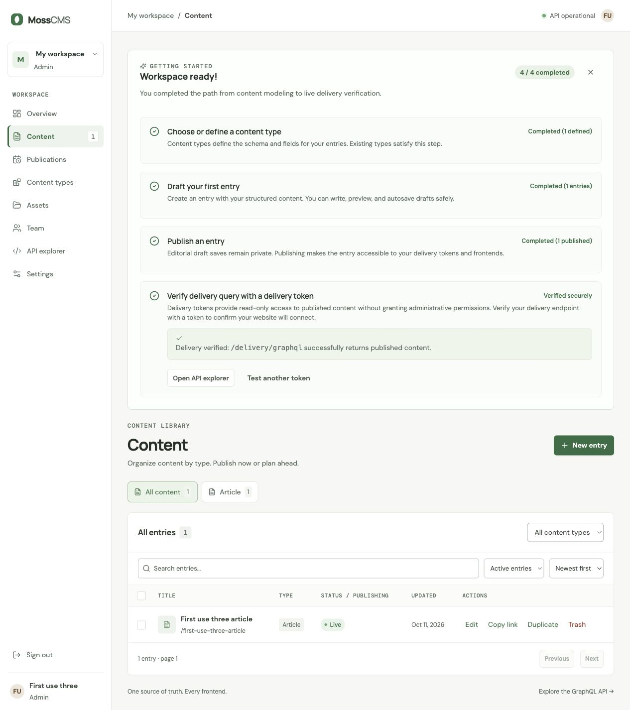

# TASK-35 first-use walkthrough three — 11 October 2026

**Result: completed agent-operated keyboard walkthrough, with an infrastructure interruption and successful resume.** This is one fresh synthetic workspace run. It is not a human participant study, an activation-rate measurement, a speech test, or release approval.

## Isolation and method

- Disposable SQLite database and media: `/tmp/moss-first-use-three-20261011/cms.db` and `/tmp/moss-first-use-three-20261011/media`.
- API/UI ports: **18113 / 15113**, bound to `127.0.0.1`. The browser initially used `127.0.0.1`; it resumed on **`http://localhost:15113`**, with backend `http://localhost:18113` and explicit matching allowed origins.
- Real authentication stayed enabled (`MOSS_SKIP_AUTH=false`). Only `/auth/setup` was bootstrapped by HTTP; the synthetic owner then signed in through the browser. S3 and OAuth configuration were blank.
- Exactly one new hidden Codex In-app Browser tab was created for this run and closed afterward. No native Safari app or another test tab, database, media directory, or file was operated.
- Article template creation, entry editing, explicit draft save, publication, scoped token creation, delivery verification, dismissal and resume used actual browser controls with **Tab, Shift+Tab, Enter, Space and text entry**. No mouse click was used. Reload and the cookie-host move used browser navigation APIs.
- The one-time token was read from the visible `New delivery token` input into a CUA-local variable, then typed into the checklist. This substitutes for copying and pasting it by hand; no API created the token or completed delivery verification. No token value was printed, saved in this document or a URL, or transmitted beyond the local fixture. The variable was cleared after verification.
- Browser identity was Codex In-app Browser; engine/version was not exposed. No standalone Chrome, Safari or VoiceOver result is claimed.
- No MossCMS `AGENTS.md` was found. The ponytail skill and the reproduction directions in `docs/editor-acceptance-2026-10-11.md` were read. Only this evidence document was added to the repository by this run. The live shared working tree received a Vite HMR update to Content/styles at 17:15:14 UTC, so this is working-tree evidence rather than a frozen revision test.

## Timing and observed outcomes

Times below are UTC on 2026-10-11 (Jerusalem was UTC+3). Browser inspection and orchestration time are included; these are not human task-completion timings. Backend audit timestamps establish schema/draft/publish/token events. Final verification time is bounded by the subsequent clock observation.

| Time | Observation |
| --- | --- |
| 17:11:45 | Synthetic owner setup finished. Browser sign-in then showed an empty workspace and checklist **0/4**. |
| 17:12:07 | Keyboard `Add Article` succeeded; checklist **1/4**, one defined type. |
| 17:12:31 | Title entry triggered the first autosaved draft. Title `First use three article`; generated slug `first-use-three-article`. |
| 17:12:47 | Body autosaved as version 2. Explicit `Save draft` was subsequently activated with Enter; UI reported “Draft saved. Existing live content and schedule are preserved.” Follow-up reads encountered the cookie collision described below. |
| By 17:14:14 | After host-isolated sign-in, the list contained exactly one unpublished entry and the checklist showed **2/4**. It explicitly said “You have 1 unpublished draft(s). Draft saves do not satisfy publication.” Keyboard publication then saved version 3 and showed **3/4** plus `Live`. |
| Before 17:15:18 | Checklist dismissal, reload and resume at **3/4** succeeded. An intentionally invalid synthetic token query showed “A valid delivery token is required” and remained **3/4**. API access log independently recorded `/delivery/graphql` **401** for that attempt. |
| 17:15:29 | Through Settings, created `First use three delivery`, Article scope, expiry **1 day**. Returning to Content still showed **3/4**, proving token creation alone did not complete verification. |
| By 17:15:52 | Typed the generated local token into `Delivery token`, activated `Test delivery query` with Enter, and observed **“Workspace ready!” / 4/4** and “Delivery verified: /delivery/graphql successfully returns published content.” API access log independently recorded `/delivery/graphql` **200**. |
| By 17:16:29 | Reload retained **4/4**. Dismissal showed `Setup checklist (4/4)`; reload retained the collapsed state; keyboard resume restored the completed checklist. Own API/UI processes and tab were cleaned up immediately afterward. |

Setup-to-observed-delivery completion took at most **4 minutes 7 seconds**, including inspection, the failed-query control and the isolation interruption. End-to-end browser verification finished by **4 minutes 44 seconds** after setup, with cleanup immediately afterward. No baseline or improved activation metric can be inferred from these timings.

## Keyboard and obstacles

- Keyboard sign-in exposed labeled `Email`, `Password` and `Sign in`. After sign-in, Tab reached `Skip to content`; Enter followed by Tab reached `Dismiss checklist`, then `Add Article`.
- New entry focused the `New entry` heading. Tab reached the `Content type` selector and required `title *` field. Description, body, slug, publishing options and final Save/Publish action all remained reachable. The body required tabbing through eight formatting/preview controls first. Existing-entry reopening focused its title heading; Publish now was reached through the documented controls using Tab and selected with Space.
- Several component replacements reported focus on the page root, while the next Tab continued near the replaced control. After publication, an assumed skip-link sequence instead activated `Dismiss checklist`. This was an operator navigation mistake, and demonstrated dismissal; inspecting focus before the next Enter resolved it. Resume likewise left focus reported on the page root; the next Tab reached `Dismiss checklist`. The run does not claim focus restoration to the checklist heading.
- Settings was reached through the checklist's `Settings → Delivery tokens` link. It opened general Settings rather than focusing/scrolling directly to the token section: nine further Tabs from the Workspace name field were required to reach Token name. The token name, expiry stepper, Article checkbox and Create delivery token were labeled and keyboard operable. Twenty Shift+Tabs from the create action reached the main Content navigation link.
- **Infrastructure interruption:** at approximately 17:13 UTC the initial UI's follow-up checklist/list queries returned “Sign in required.” Concurrent fixture login on another port of `127.0.0.1` replaced its host-scoped `moss_session` cookie. The draft remained saved. Restarting only this run's servers with `localhost` public/origin/backend configuration and navigating this same tab to localhost separated the cookie host and restored access. This is an isolation collision, not attributed to the checklist product flow. No other fixture was altered.
- Sandbox loopback binding was initially denied; authorized localhost-server escalations succeeded. Both ports remained loopback-only. Process inspection (`ps`) was denied, so the Vite process PID was not obtained; its known tool session was stopped directly.

## Evidence and cleanup

The no-token final screenshot is saved in `first-use-three-ready.jpg`; it shows all four completed checklist steps and the live synthetic entry. The original temporary fixture screenshot is also retained.

Initial API PID **40645**, tool session **37723**, and initial UI session **88361** were stopped for the cookie-host restart. Resumed API PID **42374**, tool session **30216**, and resumed UI session **97412** were stopped after verification; Uvicorn confirmed shutdown, and both Vite sessions exited with interrupt status. Only the created IAB tab **1** was closed. The temporary database/media/screenshot were retained for evidence; no active server was intentionally left running.

This run completes the observed TASK-35 path for one additional agent-operated fresh fixture. The count of three independent agent runs must be assessed alongside their other reports. Human usability/activation improvement, spoken accessibility output, other browsers, production operation and a frozen-revision repeat remain unverified.
