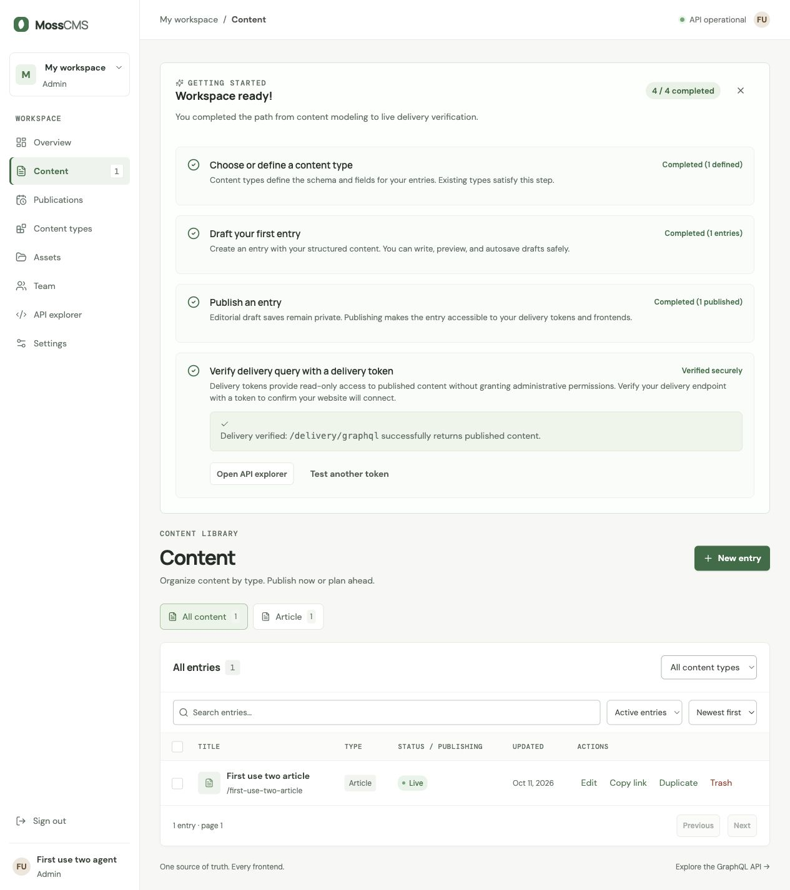

# TASK-35 first-use walkthrough two — 11 October 2026

**Result: passed in an isolated fresh workspace, operated by the root agent through CUA.** The complete checklist flow used keyboard actions and semantic field filling, without mouse clicks. This is agent-operated browser evidence, not a human first-use participant or proof of the proposed activation metric. The operator had source context.

## Isolation and timing

- Fixture: `/tmp/moss-first-use-two-20261011/`, with fresh SQLite `cms.db` and `media/`.
- API: `http://127.0.0.1:18112`; frontend: `http://127.0.0.1:15112`.
- Authentication enabled; synthetic owner bootstrapped through `/auth/setup` with HTTP 200. No existing workspace, production database, S3, or OAuth configuration was used.
- 17:11:39 UTC (20:11:39 Asia/Jerusalem): bootstrap completion and pre-browser timestamp recorded.
- Initial subagent CUA tab creation failed with `Browser is not available: iab`, and its browser inventory returned `[]`. The root session had its own in-app browser and opened a new tab for this fixture. No native Safari app or another chat's tabs were accessed.
- 17:12:57.962 UTC (20:12:57.962 Asia/Jerusalem): root's measured start immediately before entering credentials.
- Root measured **105 seconds to the first observed 4/4 checklist state**, approximately 17:14:42.962 UTC (20:14:42.962 Asia/Jerusalem). The end time is derived from the measured duration, not an exact network timestamp. This includes sign-in and a deliberately rejected token verification. Individual step timestamps were not recorded.

## Actual browser observations

| Action | Observed result |
| --- | --- |
| Sign in | Email/password fields filled by their semantic labels; Enter on Password submitted the form. The fresh checklist showed 0/4. |
| Add Article | Enter activated Add Article. Checklist advanced to 1/4. |
| Create entry and save draft | Enter activated New entry. Title and body were filled, and Enter explicitly activated Save draft. Checklist advanced to 2/4 and showed `1 unpublished draft` and `Draft saves do not satisfy publication`. Draft save did not complete the publish step. |
| Publish | Entry reopened with Enter; Publish now selected with Enter; explicit Publish now activated with Enter. Checklist advanced to 3/4. |
| Create delivery token | Settings → Delivery tokens opened with Enter. Token name and one-day expiry filled; Article scope checkbox toggled with Space; Create delivery token activated with Enter. Token creation alone left the verification step unfinished. |
| Reject invalid token | Returned to Content with Enter, filled a deliberately invalid token, and activated Test delivery query with Enter. Error read `A valid delivery token is required`; checklist remained 3/4. |
| Verify successful delivery | Filled the newly created scoped token and activated Test delivery query with Enter. Checklist advanced to 4/4 only after successful verification. The token was not printed, added to a URL, or included in this note. |
| Dismiss, reload, resume | Dismiss activated with Enter. After reload, Resume was visible. Enter activated Resume; `Workspace ready!` and 4/4 returned. |

The root agent separately asserted an authenticated delivery response containing exactly one Article, slug `first-use-two-article`, and body `Isolated first-use two published body.`. This checked actual published content rather than inferring delivery from a UI notice. The private assertion token file was removed.

## Keyboard and focus evidence

No semantic click or mouse action was used in the completed browser run. Named controls were activated with Enter, the Article scope checkbox with Space, and fields filled by semantic labels. Pressing Tab from the title field moved the observed active element to an `INPUT`.

This verifies the actions described above, including keyboard button activation and one observed Tab transition. Semantic locator targeting and filling helped the agent navigate; it was not a complete Tab-only traversal of every control. No human participant or spoken VoiceOver labels/announcements are claimed. Browser identity was Codex In-app Browser; the engine/version was not exposed, so this is not a versioned Chromium or Safari acceptance run.

## Processes and evidence

Initial sandboxed server starts could not bind loopback ports (`operation not permitted`). Authorized escalation started only these isolated servers:

- API PID `40203`, exec session `5568`.
- Frontend exec session `24087`.

No source files, canonical planning JSON, ticket statuses or unrelated working-tree changes were edited by this subagent. It owns this acceptance note and the isolated fixture. The root session supplied the actual browser transcript and screenshot, closed its temporary tab, cleared its token variable, and authorized cleanup of these servers. The disposable fixture and screenshot are retained as evidence.

At 17:17:04 UTC (20:17:04 Asia/Jerusalem), both owning exec sessions were stopped. API session `5568` reported orderly application shutdown and process `40203` finished with exit 0; frontend session `24087` ended with exit 130 following Ctrl+C. No other processes were stopped.
