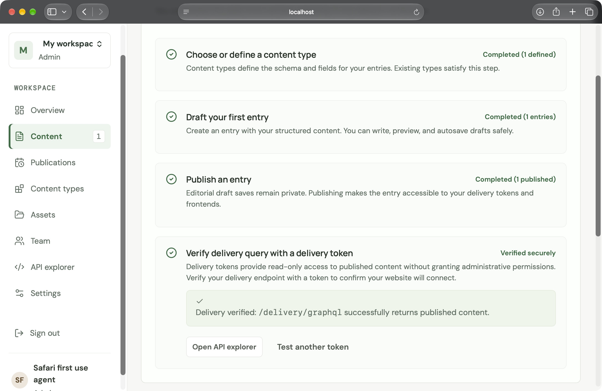
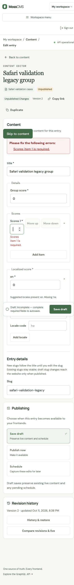
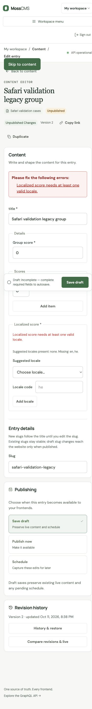
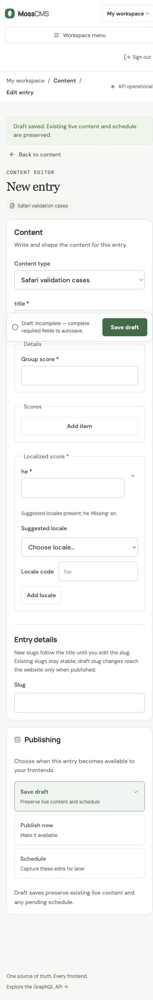

# TASK-45 empty-workspace Safari first-use — 11 October 2026

**Result: the empty-workspace Safari first-use flow completed in the root agent's actual browser session.** It reached 4/4 only after publishing and successfully verifying delivery. This is agent-operated synthetic evidence, not a human activation study, complete release approval, or proof of spoken VoiceOver behavior.

## Isolation and timing

- New fixture: `/tmp/moss-safari-first-use-20261011/`, with SQLite `cms.db` and temporary `media/`. No earlier fixture was reused.
- API: `http://localhost:18114`; frontend: `http://localhost:15114`. Both servers bind only `127.0.0.1`.
- `MOSS_PUBLIC_URL=http://localhost:18114`, `MOSS_ORIGINS=http://localhost:15114,http://localhost:18114`, and `VITE_BACKEND_URL=http://localhost:18114` match the browser's localhost origin. Localhost separates cookies from the other chat's `127.0.0.1` fixture.
- Authentication enabled, development environment, synthetic owner and fixture-only secrets, local temporary storage; S3 bucket/endpoint, OIDC discovery and GitHub client ID blank.
- At 17:23:42 UTC (20:23:42 Asia/Jerusalem), account bootstrap and localhost readiness/frontend checks returned HTTP 200. The fixture had zero types, zero entries and zero delivery tokens; only the bootstrap session existed. The frontend readiness/auth proxies also returned HTTP 200.
- Root's measured elapsed time to completion was **461 seconds**, including native browser connection interruption/recovery. Its completion clock was 17:35:43 UTC (20:35:43 Asia/Jerusalem), implying an approximate start of 17:28:02 UTC. These are an agent session's timing, not an independent participant result.

## Actual Safari observations

Browser version was **Safari 27.0.1, build 22625.1.29.11.28**, as previously read from installed app metadata. The root agent waited for the other chat's native Safari work to finish before this run. This subagent only prepared the fixture and performed guarded API assertions.

| Action | Observed result |
| --- | --- |
| Create type | Fresh checklist began at 0/4. Article created through the checklist; progress became 1/4. |
| Create draft | Entered title `Safari first-use article`, description `Synthetic Safari acceptance.`, and body `Safari original published body.`. Explicit Save draft returned to Content at 2/4, with `1 unpublished draft(s). Draft saves do not satisfy publication`. |
| Publish | Opened the entry row through Option-Tab and Space, selected the explicit Publish option, then activated Publish. Checklist became 3/4. |
| Create token | Opened Settings by keyboard. Created a token named `Safari first-use one-day Article`, expiry one day, scoped only to Article. Token creation alone did not complete verification. |
| Reject invalid token | Deliberately invalid synthetic token produced `A valid delivery token is required`; progress stayed 3/4. |
| Successful verification | The actual token successfully verified delivery, and progress reached 4/4. No credential appears in this note, screenshot or URL. |
| Back/Forward navigation | Browser Back/Forward retained search `Safari first`, sort `title_asc` and the entry route. |

Product actions used Option-Tab, Shift-Option-Tab, Space, Return and paste. The browser's save-password offer was declined with a mouse click outside the product. A native connection loss once rebound another window; the root recovered its owned window `2FD7B29B-F37F-4F1F-A38A-E178FF4935F8` using the Window menu, which required mouse navigation. This interruption is included in the elapsed time. Full Tab-only navigation and first-use dismissal/reload/resume were not separately evidenced in the supplied Safari transcript.

Root also tried clearing the Article title to test dirty-navigation cancellation. Empty strings are valid under the established schema rules, so autosave completed and Settings navigation proceeded. This was **not** proof of a dirty-navigation cancellation flow; a required numeric field is prepared separately below for that check.

The root later restored the Article title through the in-app browser with an explicit Save draft, without publication.

## Independent delivery assertion

At 17:37–17:38 UTC, this subagent authenticated to the fixed disposable localhost API and guarded the exact fixture path, database, synthetic email/name, account ID and sole workspace/admin membership before making requests. The delivery credential was read only from its regular mode-0600 private fixture file and sent in the Authorization header.

An actual `/delivery/graphql` response contained exactly one Article, slug `safari-first-use-article`, with body **`Safari original published body.`**. The editorial published snapshot was live with the same exact body. This assertion passed again after preparing the separate validation type; the Article publication was unchanged. No publication outcome was inferred from a toast or checklist alone.

## Separate validation preparation and actual in-app checks

Only the new `safariValidation` type, named **Safari validation cases**, and its separate synthetic draft were seeded. The preparation API did not edit Article schema/content. Private fixture IDs and accepted fields are saved in `/tmp/moss-safari-first-use-20261011/validation-fixture.json` with mode 0600. Workspace defaults were initially `en`, with suggestions `[en]`; they were not changed through the preparation API.

At preparation time, the draft **Safari validation legacy group** (`safari-validation-legacy`) was valid at schema version 2 and entry version 2, with `details.score=0`, `scores=[0]`, and `localizedScore={en:0}`. Browser saves later advanced its version. Required empty strings and lists intentionally remain valid; the numeric fields provide unambiguous missing-value errors.

| Reproduction instruction | Expected path and recovery |
| --- | --- |
| Clear **Group score**, explicitly Save | `data.details.score`: `Group score is required.` Focus should return to the number input. Restore `0`. |
| Clear the first **Scores** number, explicitly Save | `data.scores[0]`: `Scores item 1 is required.` Restore `0`. |
| Clear **en** under **Localized score**, explicitly Save | `data.localizedScore.en`: `Localized score (en) is required.` Restore `0`. |
| Remove the only en translation, explicitly Save | `data.localizedScore`: `Localized score needs at least one valid locale.` Expected focus target is the localized fieldset. Add en and enter `0` to recover. |
| Leave a required number invalid, attempt navigation | Autosave should remain blocked; exercise the navigation confirmation's Stay action and verify retained route/form state before recovery. |
| Set workspace default to he and suggestions he,en through Settings; create a new validation entry | Existing saved en maps should remain unchanged. The new entry's localized score should initialize a he translation. Enter `0` and valid group/list values before saving. |

An attempted type upgrade requiring an absent Details object was rejected by the API with field path `data.details`. Schema migration validates all existing entries and will not create that invalid legacy state. A safe migration supplied `details:{score:0}` and succeeded. Thus the true missing-object fieldset focus variant cannot be generated by this authorized API path; group focus remains automated evidence unless a normal browser path exposes it. No direct database write or weakened validation was used.

Repeated native Safari focus interruptions prevented a reliable continuation, so the root performed the following additional checks in a background **Codex In-app Browser** at **390×844**. Its engine/version was not exposed. These are in-app observations; they are not labeled Safari passes.

| Actual browser action | Observed result |
| --- | --- |
| Clear Scores item 1 and explicitly Save | `Scores item 1 is required.` Explicit Save focused `field-data.scores%5B0%5D`; activating the summary link returned focus to the same number input. Client width and scroll width were both 375px, with no horizontal overflow. |
| Clear en localized number and explicitly Save | `Localized score (en) is required.` The summary link focused `field-data.localizedScore.en`. |
| Remove the sole en translation and explicitly Save | `Localized score needs at least one valid locale.` Initial validation focus went to `field-data.localizedScore`; Enter on its summary link correctly returned focus to that localized fieldset. |
| Clear Group score and explicitly Save | Focus returned to the nested Group score input. This verifies child recovery, not a missing object fieldset. |
| Restore numeric values and en translation | Entering `0` in the group, list and en number controls saved a valid draft with no errors. |
| Change locale defaults through Settings | Default `he`, suggestions `en,he` saved with `Locale defaults saved`. The existing en translation was preserved. A new Safari validation entry initialized only a blank he number translation, with en missing. |
| Invalid Scores, then Back to Content | Navigation left the editor without a JavaScript dialog observable through the available `getJsDialog` tool (`undefined`). Cancel/Stay was **not verified**. This does not establish an application defect without a reliable native-browser confirmation. |

Two pointer attempts on the localized-group validation summary focused `main-content` instead. The cause was not confirmed and could involve tool targeting or overlap. Keyboard Enter on the summary link worked; **no pointer-focus pass is claimed**.

## Processes and limits

- API PID `56872`, exec session `10851`.
- Frontend exec session `27402`.

At root authorization, both owning sessions were stopped at 17:42:10 UTC (20:42:10 Asia/Jerusalem). API session `10851` reported orderly application shutdown and PID `56872` finished with exit 0; frontend session `27402` ended with exit 130 following Ctrl+C. Only the regular mode-0600 `/tmp/moss-safari-first-use-20261011/delivery-token` file was unlinked. SQLite fixtures, private non-secret IDs and screenshots remain as evidence. The root owns browser/window cleanup; this subagent did not operate them.

The updated acceptance report and full planning criteria were read. A read-only task-context request through this subagent's exposed Aftur tool returned `not_found`; no ticket claim, status or canonical planning file was changed. No source file was edited by this subagent. Other fixtures, notes and existing working-tree changes are preserved.

This result supplies the previously missing empty-workspace Safari first-use evidence and additional in-app keyboard validation/default-locale results. Standalone Chromium and spoken VoiceOver remain owner-deferred. Dirty-navigation Cancel/Stay, pointer summary-focus recovery, and true missing-object fieldset recovery remain unverified as described above. Production deployment acceptance and universal accessibility claims are outside this run.
