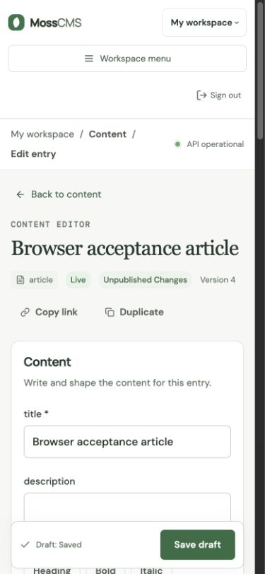
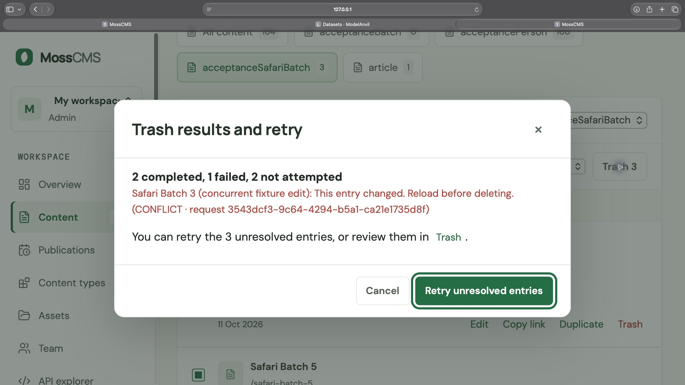
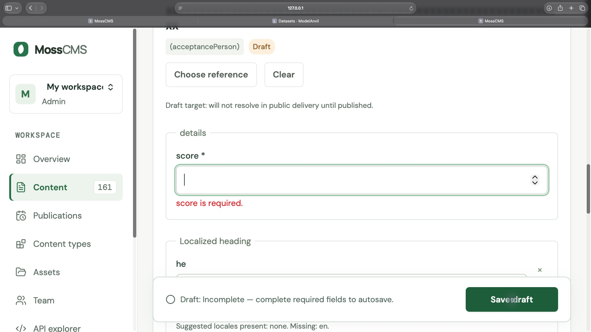

# Editing improvements acceptance — 11 October 2026

Product changes for MC-35–MC-44 / TASK-35–TASK-44 are implemented in the working tree. The owner authorized implementation and parallel subagents in this Codex chat. Aftur now records TASK-35–TASK-44 as Done following owner acceptance. MC-45 has **partial browser verification**, not release approval.

## Automated evidence

| Check | Result |
| --- | --- |
| `cd web && npm test` | 178 tests passed across 26 files (final integration rerun) |
| `cd web && npm run check` | Passed |
| `cd web && npm run build` | Passed |
| `cd api && .venv/bin/python -m pytest -q` | 123 passed, 2 skipped |
| `cd api && .venv/bin/ruff check app tests` | Passed |
| `cd api && .venv/bin/mypy app` | Passed, 19 source files |
| `cd personal-site && npm test` | 42 passed |
| `cd personal-site && npm run build` | Passed |

The two default-run skips require PostgreSQL. A separate run against actual **PostgreSQL 17.11** passed **22 tests with no skips**: populated `0008` → `0009` migration, product improvements, publication, concurrency and outbox. Twenty-one used PostgreSQL; one existing test explicitly used SQLite. The migration preserved working/live/scheduled localized data, slugs, versions, timing and history; scheduler/outbox locking and competing homepage publication rollback passed. The cached `postgres:17-alpine` image ran in a disposable container with temporary storage on loopback port 18112; it was removed afterward. This was a synthetic rehearsal, not a production-data restore or deployment. API deprecation warnings and jsdom's unimplemented `scrollTo` notices did not fail checks.

## Actual browser evidence

The original HTTP/browser writes targeted a temporary SQLite database, temporary media directory, and a synthetic workspace on loopback ports **18111/15111**. Supplementary Safari first-use and in-app validation checks used a separate disposable fixture on **18114/15114**, described in the linked supplement. Existing development and production workspaces were not used. The fixture contained 160 reference targets, an Article, and five batch entries.

| Journey | Observed result |
| --- | --- |
| First-use setup, in-app browser | Created the Article template from the checklist, explicitly saved a draft, published it, and verified delivery using a scoped synthetic delivery token. Checklist reached 4/4 and dismissal/resume worked. Draft alone did not complete publication. |
| Empty-workspace first-use, Safari | Fresh zero-type/zero-entry fixture on localhost ports 18114/15114: keyboard creation, explicit draft save (2/4, publication incomplete), explicit publish (3/4), scoped one-day Article token, rejected invalid token then successful delivery (4/4). Exact published body was asserted through authenticated HTTP. Dismissal/reload/resume retained 4/4. Agent-operated elapsed 461 seconds includes native connection/window recovery. [Supplementary steps and limits](acceptance-2026-10-11/safari-first-use.md). |
| Additional validation/default locale, in-app browser | In a separate synthetic validation type at 390×844, list-item, localized-number and empty-locale-group errors exposed labels, inline text and focused targets; keyboard summary links returned the control/group. Zero-value recovery saved. Changing workspace default to Hebrew preserved the existing English map; a new entry initialized Hebrew. Client/scroll widths were 375px. Pointer locale-group summary targeting and canceled dirty navigation remain unverified; the supplement records the observations. |
| Reference beyond first 100, in-app browser | Searched for and selected `Acceptance person 000`, the oldest of 160 targets. Saved the reference, then reloaded a direct entry link; its label remained visible and the draft-target delivery explanation remained present. |
| Direct-entry navigation, in-app browser | Reload retained entry/type context. Final signed-out deep-link → password sign-in retest retained workspace, entry ID and type and opened the correct editor. |
| Direct-entry navigation, Safari | Final signed-out deep-link → password sign-in retained workspace, entry ID and type and opened the correct Article. Signed-in direct entry also retained the independently resolved reference label and draft body. |
| Nested validation, Safari | Blank `details.score` rejected explicit save; the summary exposed “score is required” and focus returned to the labeled control. Repeated at actual 200% zoom: the focused control, visible focus ring, inline error and sticky Save were visible together. Restoring `0` cleared the error and keyboard navigation reached the Hebrew translation. The earlier VoiceOver-enabled run verified accessibility text/focus only. |
| Draft/live isolation | After an actual browser draft save changed the body to `Changed draft body.`, an authenticated delivery HTTP query still returned `Original published body.`. Safari's explicit Publish now then replaced delivery with `Changed draft body.`; an HTTP assertion confirmed the exact value. Publication was not inferred from the UI message. |
| Interrupted bulk trash, in-app browser | A concurrent HTTP edit after confirmation caused a five-item operation to report **2 completed, 1 failed, 2 not attempted**. A later three-item operation reported **2 completed, 1 failed, 0 not attempted**. Explicit Retry unresolved entries removed only the failed item. All five ended in Trash with versions `[2,2,3,2,3]`; completed items were not mutated again by retry. |
| Safari reference and delivery | Independently searched and selected the oldest target out of 160, retained its label after save, and verified the delivery token through the checklist at 200% zoom; it reached 4/4. This reused a prepared workspace, not a second empty-workspace setup study. |
| Interrupted bulk trash, Safari at 200% | Confirmed by keyboard; forced conflict reported **2 completed, 1 failed, 2 not attempted** and focused **Retry unresolved entries**. Space retried only the unresolved entries, then focused the content-list heading. HTTP assertions checked partial versions `[4,4,5,3,3]` and final deleted versions `[4,4,6,4,4]`; the completed entries stayed at version 4. These versions reflect an explicit fixture reset before the final repeat. |
| Revision comparison, in-app browser | Compared saved v1 and v5: original/changed body, added reference and nested score `0` were readable. Hide unchanged fields worked; current comparison resolved the beyond-first-100 reference label. Escape returned focus to the comparison opener. A stale fixture session initially prevented lookups; re-login resolved it without a comparison change. |
| Media upload, in-app browser | Uploaded a synthetic 32×32 PNG from the editor's native file chooser. It was selected automatically, “Uploaded and selected acceptance.png” was exposed as status text, and focus returned to Choose asset. Image insertion into Markdown was not part of this check. |
| Locale recovery, in-app browser | Invalid custom code `??` exposed format guidance; replacing it with `he` added a translation. Hebrew text survived save/reopen. An API assertion verified the draft map `{he: בדיקת קבלה}` while the published translation map remained unchanged. |
| Long reference title reflow | A selected 120-character unbroken title originally made the 390px editor scroll width 1507px. After wrapping fixes, client/scroll widths were both 375px. Safari's 200% view also showed the selected title wrapping with Choose reference, Clear and Save reachable. |
| Narrow viewport | At a 390×844 viewport, the full-page editor and sticky Save control remained reachable. DOM client width and scroll width were both 375px (scrollbar consumes the remainder), with no horizontal overflow. Saved screenshot below. The bulk confirmation/result/retry also completed at this width. |
| Keyboard/VoiceOver | macOS VoiceOver was temporarily enabled with explicit owner permission. Native accessibility exposed field labels, validation text and focus recovery. VoiceOver was subsequently observed off, matching its original setting. Speech/audio output was unavailable to the automation tool; spoken recovery announcements were **not verified**. |

Safari version read from its installed app metadata: **27.0.1, build 22625.1.29.11.28**. The in-app browser exposes a Codex In-app Browser identity, but the underlying engine/version was not exposed by the available tool; do not treat it as a versioned standalone Chromium run. Actual 200% zoom was confirmed through Safari’s Page Menu percentage selector. Safari’s keyboard navigation used Option-Tab to reach buttons under the existing browser settings. Standalone Chromium is not installed; the owner explicitly chose to retain existing apps and leave its checks for manual review. The owner also explicitly deferred spoken VoiceOver verification. No new software was installed or VoiceOver setting changed during this continuation. A complete versioned second-browser run is not claimed.







[Successful Safari retry](acceptance-2026-10-11/safari-bulk-success-200.jpg), [long reference at 390px](acceptance-2026-10-11/editor-long-reference-mobile.jpg), and [long reference at Safari 200%](acceptance-2026-10-11/safari-long-reference-200.jpg) provide additional visual evidence.

## Failures fixed during integration

- Workspace navigation briefly exposed previously loaded schema/count state. Workspace-keyed data and a loading gate now prevent stale content from mounting; integration tests include pending, failed and out-of-order loads.
- Valid URL type filters could be dropped before schemas loaded. Route normalization waits for the selected workspace data.
- Password sign-in always replaced the requested route with `#content`. It now retains valid administration deep links; invitation/reset completion still removes authentication-token routes.
- Recursive validation targets needed stable field IDs and focusable object/list/locale groups. Failed explicit saves focus the appropriate control; background autosave does not move focus.
- Shared dialogs did not reliably restore focus to the keyboard opener on Escape/Cancel. They now restore a connected, enabled opener with regression coverage.
- Safari lost focus when a bulk action became disabled during the request. Partial completion now focuses Retry; full completion focuses the stable content-list heading. Deferred-request regression tests cover both, including a removed toolbar opener.
- Long selected reference titles overflowed narrow editors. Reference summaries/results now wrap and constrain labels and metadata.
- The hidden upload input received Tab focus. It now stays out of the Tab order; the visible upload button owns the action. Successful picker searches expose result status text; actual speech remains manual.
- Initial bulk confirmation omitted schedule cancellation. It now explicitly says pending schedules are canceled.
- URL ownership locking could invert publication/scheduler lock order. Database path uniqueness now arbitrates competing claims, with conflict responses and transactional rollback coverage.

## Reproduce the disposable environment

From the repository root, use fresh paths. Do not reuse the production database, media directory, OAuth settings or credentials. These deliberately synthetic credentials are only for this fixture.

```sh
mkdir -p /tmp/moss-acceptance-20261011/media
DATABASE_URL=sqlite:////tmp/moss-acceptance-20261011/cms.db \
MOSS_SKIP_AUTH=false MOSS_ENV=development \
MOSS_SECRET_KEY=acceptance-only-secret-20261011-abcdefgh \
MOSS_SETUP_TOKEN=acceptance-only-setup-20261011 \
MOSS_STORAGE_DIR=/tmp/moss-acceptance-20261011/media \
MOSS_S3_BUCKET='' MOSS_OIDC_DISCOVERY_URL='' MOSS_GITHUB_CLIENT_ID='' \
MOSS_PUBLIC_URL=http://127.0.0.1:18111 \
MOSS_ORIGINS=http://127.0.0.1:15111,http://127.0.0.1:18111 \
api/.venv/bin/python -m uvicorn app.main:app --app-dir api \
  --host 127.0.0.1 --port 18111
```

In another terminal, initialize this fresh API only:

```sh
api/.venv/bin/python - <<'PY'
import httpx
response = httpx.post('http://127.0.0.1:18111/auth/setup', json={
    'token': 'acceptance-only-setup-20261011',
    'email': 'acceptance@example.test',
    'password': 'synthetic-acceptance-password',
    'name': 'Acceptance tester',
})
response.raise_for_status()
PY
```

Start the UI in another terminal:

```sh
cd web
VITE_BACKEND_URL=http://127.0.0.1:18111 npm run dev -- \
  --host 127.0.0.1 --port 15111 --strictPort
```

1. Sign in at `http://127.0.0.1:15111`. Use the checklist to create an Article type. Create `browser-acceptance-article`, title `Browser acceptance article`, body `Original published body.`. Save draft first, then explicitly publish. Create a one-day Article-scoped delivery token in Settings and verify it through the checklist.
2. From the repository root run `api/.venv/bin/python scripts/editor_acceptance_fixture.py` **once**. It refuses a non-fixture account or already-seeded types and writes test IDs/token to `/tmp/moss-acceptance-20261011/fixture.json` with mode 0600. No token belongs in screenshots, URLs, checked-in files or logs.
3. Reload Content. Open the Article, find `Acceptance person 000` in Related person, set `details.score` to zero, change body to `Changed draft body.`, and save draft. Query `/delivery/graphql` with the synthetic token in the Authorization Bearer header; assert the old body is unchanged. Publish through the UI; assert the new body is delivered.
4. Copy the entry link. Check reload, signed-out sign-in, back/forward, filter restoration and canceled dirty navigation. Repeat independently in a versioned Chromium browser and Safari.
5. Clear score and explicitly save. Check summary link, focused control, readable inline error, then zero-value recovery. Test list-item and locale errors as well; supplementary in-app checks cover keyboard targeting/recovery at 390px. Complete Safari/assistive repetitions and pointer targeting remain manual.
6. Filter `acceptanceBatch`, sort Title A–Z, select all five and open Trash confirmation. Before confirming, use a second authorized editorial session to save a title change to the third entry with its current version. Confirm; expect 2 completed, 1 failed, 2 not attempted. Retry unresolved entries explicitly; verify all five have status `deleted` and completed versions do not change during retry. Use Trash to inspect recovery.
7. Repeat primary actions, dialogs and validation at 390px and **actual 200% browser zoom**. Enable VoiceOver only with owner permission, test reading order, labels, dialog focus, summary links, status announcements and keyboard recovery, then restore its original setting.

## Reusable browser assertions

The guarded helper only accepts the disposable API/database/account above and keeps fixture state in a private regular mode-0600 file. It does not print delivery credentials. On a fresh seeded environment:

```sh
api/.venv/bin/python scripts/editor_acceptance_smoke.py self-check
api/.venv/bin/python scripts/editor_acceptance_smoke.py assert-delivery \
  --expected-body 'Changed draft body.' --expected-draft-body 'Changed draft body.'
api/.venv/bin/python scripts/editor_acceptance_smoke.py seed-batch --name safari
# Open the five-item Safari confirmation, then force the third-item conflict:
api/.venv/bin/python scripts/editor_acceptance_smoke.py bump-batch-version --name safari --item 3
# Confirm through the browser, then inspect the partial result:
api/.venv/bin/python scripts/editor_acceptance_smoke.py assert-batch --name safari \
  --statuses deleted,deleted,draft,draft,draft --versions 2,2,2,1,1
# Activate Retry unresolved entries through the browser:
api/.venv/bin/python scripts/editor_acceptance_smoke.py assert-batch --name safari \
  --statuses deleted,deleted,deleted,deleted,deleted --versions 2,2,3,2,2
```

Use `reset-batch --name safari` only for an intentional repeat; restore creates newer draft versions. Adjust expected versions to its printed baseline. The final run here used `[3,3,4,3,3]` before conflict, producing the exact results recorded above.

For the PostgreSQL rehearsal, set `MOSS_TEST_DATABASE_URL` to a separate disposable PostgreSQL database and run from `api`:

```sh
.venv/bin/pytest tests/test_postgres_product_migration.py tests/test_product_improvements.py \
  tests/test_publication.py tests/test_concurrency.py tests/test_outbox.py -q --tb=short
```

The integration fixture recreates its test schema. Never point this variable at a development workspace or production database.

## Remaining acceptance work

- **Owner-deferred:** versioned standalone Chromium repetition and a human VoiceOver listening walkthrough for spoken labels/status/recovery announcements. Accessible trees do not prove speech behavior or accessibility conformance.
- The empty-workspace Safari first-use path is now complete in the linked supplement. Remaining browser variants include canceling dirty navigation, pointer locale-group summary targeting, and full repetition of every critical journey in standalone Chromium and assistive technology.
- TASK-35’s three first-use walkthroughs are now recorded: this report plus [walkthrough two](acceptance-2026-10-11/first-use-two.md) and [walkthrough three](acceptance-2026-10-11/first-use-three.md), produced concurrently in separate fixtures. Aftur records owner acceptance. They are agent-operated; the proposed human activation metric remains unmeasured and is not a claim of usability improvement.
- List-item/required-locale and localized-group keyboard recovery plus new-entry default initialization now have supplementary in-app browser evidence. A missing-object group variant could not be created through the validated API without bypassing safeguards; it remains automated-only. Broader media/revision and assistive interactions still require review.
- Deployment acceptance and a rehearsal on a separately restored production-like PostgreSQL database/media pair remain outside this synthetic run. Deploy the API and personal-site together as described in [deployment recovery](deployment-recovery.md).

TASK-45 remains partial for manual acceptance in Aftur. Its dependencies are now owner-accepted; this agent did not change their completion states. No production deployment or universal accessibility claim was performed. The root swarm records the owner’s explicit acceptance for TASK-1–44; TASK-45 has no outcome acceptance. Reproducible steps/results and fixture helpers were saved in local evidence commit `adba95b`; implementation remains in the existing working tree. Existing unrelated changes are preserved. Temporary browser overrides and services are restored/stopped after verification.
